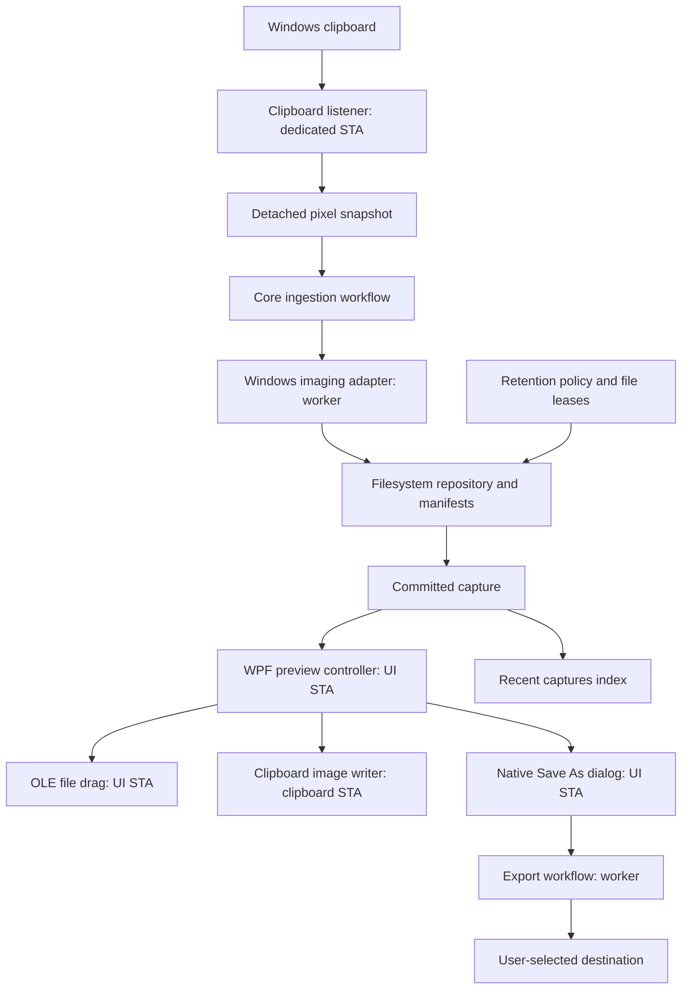

# SnapDrop architecture

Status: proposed architecture for v0.1. See [Implementation.md](../Implementation.md) for scope and delivery order.

## 1. Runtime and dependencies

SnapDrop runs as one normal, unelevated desktop process in the interactive user's session. WPF owns the primary STA and message loop. A dedicated clipboard STA isolates clipboard reads from the visible UI. Background tasks encode images and perform filesystem work.



Compile-time references:

```text
SnapDrop.App ────────────> SnapDrop.Core
      ├─────────────────> SnapDrop.Windows ────────> SnapDrop.Core
      └─────────────────> SnapDrop.Infrastructure > SnapDrop.Core
```

- App: composition, WPF windows/view models, preview controller, and application shutdown.
- Core: metadata, pure policies, workflow coordination, and narrow adapter contracts.
- Windows: clipboard, image encoding, monitor/OS integration, native dialogs, tray, and WPF drag adapters.
- Infrastructure: disk repository, atomic writes, manifests, settings, leases, and local logging.

App and Windows target `net10.0-windows` with `UseWPF=true`. Windows also enables `UseWindowsForms=true` for NotifyIcon. Core and Infrastructure target `net10.0`. Enable Windows SDK projections/versioned Windows TFM only when the v0.2 WinRT capture adapter needs them.

Use `asInvoker` and PerMonitorV2 in the executable manifest. Do not request administrator privileges to make a drop target accept a file. Different integrity levels can affect cross-process interactions; record actual supported behavior.

## 2. Core data contract

The following types illustrate the intended contract, not existing source code:

```csharp
public enum ScreenshotSource { Clipboard, NativeCapture }

public sealed record ExportRecord(
    string Path,
    string Format,
    DateTimeOffset SavedAtUtc);

public sealed record ScreenshotRecord(
    Guid Id,
    DateTimeOffset ReceivedAtUtc,
    ScreenshotSource Source,
    int PixelWidth,
    int PixelHeight,
    string ManagedFileName,
    long OriginalFileBytes,
    bool IsKept,
    DateTimeOffset LastAccessAtUtc,
    DateTimeOffset? LastTransferAtUtc,
    IReadOnlyList<ExportRecord> Exports);
```

`ReceivedAtUtc` is the time SnapDrop received the clipboard image; the true screenshot time is unknown in companion mode. Native capture can add an actual capture timestamp later. Internal names are generated from trusted IDs; exports can have several paths, so one mutable `SavedPath` is insufficient.

`CapturedFrame` owns detached, immutable BGRA32 pixel data, dimensions, stride, source, and ingestion identity. The clipboard adapter must copy the pixels before handing the frame off. Its memory ownership is explicit and disposed/released after encoding and thumbnail work complete. It contains no BitmapSource, HWND, UIElement, IDataObject, or COM object in Core.

Repository contracts commit an original and return a record, open an original for reading, enumerate valid manifests, update metadata, and delete one managed capture. ImageEncoder accepts a frame or original stream and an export format. File leases identify a capture and purpose; disposal releases the lease. Use `TimeProvider` in timing/retention policies for deterministic tests.

Business workflows return typed success/cancel/failure results. Cancellation is normal and does not generate an error toast. Never report a save before the destination file is completely committed.

## 3. Threads and ownership

- **WPF UI STA:** create/show windows, bind small thumbnails, handle input, show SaveFileDialog, and call DragDrop.DoDragDrop. Do not use Task.Run to initiate OLE drag.
- **Clipboard STA:** own the hidden HwndSource, listener registration, clipboard access, and self-marked writes. Maintain its dispatcher/message pump and marshal completion back to App.
- **Workers:** encode/resize detached pixels and perform disk I/O. Create, use, and dispose imaging objects on their assigned thread; any WPF Freezable crossing threads must be frozen first.
- **Repository writer:** serialize manifest mutations and recovery/cleanup decisions. History notifications contain immutable records. Avoid concurrent JSON rewrites from multiple operations.

Never synchronously wait on UI work from a worker or clipboard callback. OLE drag runs a nested message loop: new clipboard events, timer ticks, and shutdown requests can arrive while a drag is active. A reentrancy guard pins the current capture identity throughout the interaction.

Limits for the first qualification build:

- At most 32 million decoded pixels and 128 MiB of raw pixel data per image; checked arithmetic validates width × height × bytes-per-pixel and stride.
- One active encoding task and at most one pending detached frame; a third event is rejected with a visible overload indication if no slot can be reserved. Never allocate a frame before reserving its capacity.
- A bounded metadata-only notification queue; coalesce repeated pending notifications, not committed captures.
- Recent loads at most 50 thumbnails initially and pages older entries. Do not retain every full-resolution image in memory.

These limits are release defaults to measure and tune, not proof of a fixed peak memory footprint. Clipboard producers can replace unread images; no monitor can guarantee lossless ingestion of arbitrarily fast clipboard changes.

## 4. Clipboard ingestion algorithm

1. On explicit opt-in, create the hidden window and call AddClipboardFormatListener. Snapshot the current sequence as a baseline without ingesting an image already present at enable time.
2. WM_CLIPBOARDUPDATE records the current sequence and schedules work, then returns immediately. A zero sequence/access failure is handled as unavailable, not a valid capture identity.
3. Ignore already processed sequence notifications within this process. Treat sequence IDs as transient change tokens, not monotonic capture IDs or restart-persistent identifiers.
4. Try supported image formats: registered PNG where present, DIB/DIBV5/bitmap through the validated adapter path. Ignore text-only, file-only, HTML-only, and unsupported image events.
5. For clipboard-busy failures, schedule bounded retries at approximately 20, 50, 100, and 200 ms. Recheck the sequence before retrying; if it changed, discard the stale attempt and process the latest image event.
6. Inspect SnapDrop's custom data format marker. Suppress a matching process-instance token for SnapDrop's own writes; sequence tracking is secondary. Do not use a global “ignore the next update” boolean.
7. Validate dimensions before expensive decode where the format exposes headers, reserve a memory slot, and snapshot into detached pixels. WPF clipboard convenience APIs may internally render bitmap data; document any allocations not controllable before decode.
8. Reconcile the sequence after snapshot. If the clipboard changed, discard stale pixels and reschedule. Delayed rendering can itself affect the sequence: retry with a bounded policy rather than claiming an atomic snapshot from two sequence reads.
9. Assign a new Guid, UTC receipt timestamp, and source=Clipboard. Process one ingestion per successful event identity. Identical pixels from a later independent event are legitimate captures.
10. Encode and persist the managed original and manifest. Only then publish Ready to App and Recent.

Origin process/owner metadata may aid diagnostics but never proves that the pixels came from Snipping Tool. No background inspection of other processes' image files is required. Do not watch Snipping Tool's save folder in addition to clipboard ingestion in v0.1; it adds duplicate-source ambiguity and configuration complexity.

Clipboard reads can invoke another process's delayed rendering and block synchronously. A task cancellation token cannot forcibly interrupt that native call. Isolating the clipboard STA protects UI responsiveness; hard isolation in another process would be a separate resilience enhancement. Keep shutdown joins bounded and record this limitation.

## 5. Persistence and recovery

Use an application-owned root under the current user's LocalApplicationData known folder:

```text
%LOCALAPPDATA%/SnapDrop/
├── settings.json
├── settings.previous.json
├── Library/
│   └── <capture-guid>/
│       ├── Screenshot_<local-time>_<short-id>.png
│       ├── capture.json
│       └── thumbnail.png                  # rebuildable cache
└── Logs/
    └── snapdrop-<date>.log
```

Managed originals are recovery files with a policy, not anonymous OS temporary files. Friendly, collision-resistant basenames also become the names Explorer sees during a drag. Metadata stores a relative generated basename, not a user-controlled path.

Commit protocol:

1. Create a new capture directory from a generated ID beneath the canonical managed root.
2. Encode to a unique sibling `.partial` file; close/flush the completed stream and rename to the final PNG name on the same volume.
3. Write a schema-versioned manifest to a sibling `.partial`; replace/rename it after serialization succeeds.
4. Treat a valid manifest plus a readable matching PNG as the logical commit. Publish no success before that point.
5. Generate/cache a small thumbnail; its failure does not invalidate a good original and metadata.

This is a recoverable two-file commit, not a filesystem transaction or absolute guarantee against sudden power loss. On startup, validate manifests, ignore partial entries, recover or quarantine orphan originals, and expose a recovery notice when a user might need to intervene. Never recursively purge unknown files.

An in-memory Recent index is rebuilt from manifests. A future cache/index can accelerate startup; it remains rebuildable. JSON avoids a database dependency for a small MVP without making concurrency rules optional.

## 6. Image and accuracy contract

- Preserve source pixel dimensions in the managed PNG. Resize only thumbnail copies.
- Normalize clipboard pixels to a documented BGRA32 representation; avoid logical-DPI scaling of original pixels.
- PNG is the lossless managed/export format relative to the pixels SnapDrop received. Companion mode cannot recover color data or pixels already changed by the producer or clipboard conversion.
- JPEG is a deliberate lossy export: quality 92, explicit opaque white background for alpha, unchanged dimensions.
- Decoder/cache objects load fully and release source file handles; the viewer must not prevent exports or cleanup forever by keeping decoder streams open.
- Validate dimensions/stride and file signatures, not just filename extensions. No “rename PNG to .jpg” implementation.
- v0.1 qualification is SDR. Do not claim exact HDR appearance or ICC equivalence without a separately specified and tested color pipeline.

## 7. File drag transaction

1. Mouse-down records screenshot ID and pointer position; it does not start a drag.
2. Crossing SystemParameters.MinimumHorizontalDragDistance/MinimumVerticalDragDistance begins drag if the capture is Ready. A click that remains below thresholds opens the viewer.
3. Acquire a file lease; confirm the original still exists and is readable.
4. Persist LastTransferAtUtc before handing the path outside the process. Set a conservative protection deadline at least 24 hours beyond transfer completion; interrupted drags retain the recorded attempt time.
5. Create a DataObject with DataFormats.FileDrop containing one absolute existing PNG path. Offer DragDropEffects.Copy only.
6. Call DragDrop.DoDragDrop on the UI STA. Keep the current preview/capture pinned and all payload resources alive through the call.
7. In finally, release active drag resources, update transfer time, resume the preview policy, and handle the latest pending preview.

The first payload is FileDrop only. A bitmap/PNG auxiliary format is a compatibility experiment behind a testable switch; some targets choose a different format when several are offered. Virtual file descriptors/streams are deferred because real persisted files already satisfy the core workflow.

None means cancelled/rejected, and Copy means the target accepted the transfer effect. Neither tells SnapDrop whether a chat upload completed. Do not mark external uploads as successful or delete the managed original based on the return value.

Keep the original through ordinary retention plus transfer grace. A target can defer reading a real path beyond DoDragDrop; there is no universal completion signal. For long-lived path references, users must Keep or export the image. See [Shell transfer architecture](https://learn.microsoft.com/en-us/windows/win32/shell/dragdrop).

## 8. Copy transaction

Load the managed original under a read lease, prepare interoperable bitmap data, and add SnapDrop's custom process-instance marker. On the clipboard STA, write the DataObject with persistence across app exit (`Clipboard.SetDataObject(data, true)` or equivalent tested OLE flush behavior).

The default Copy action copies image data, not a managed file path, so expiry does not invalidate a normal later image paste. Add PNG bytes as an auxiliary format only after round-trip testing against release targets. Keep streams alive until serialization/flush completes.

Retry busy failures with a bounded schedule and show success only after the write succeeds. Monitor self-suppression in automated tests. Monitoring itself never writes to or clears the clipboard. [Persistent clipboard API](https://learn.microsoft.com/en-us/dotnet/api/system.windows.clipboard.setdataobject?view=windowsdesktop-10.0).

## 9. Save As and export transaction

1. Explicit Save As activates a normal owner/viewer window if needed and pauses preview expiration. A window permanently marked WS_EX_NOACTIVATE cannot also be treated as an accessible interactive dialog owner without deliberate activation handling.
2. Show Microsoft.Win32.SaveFileDialog on the UI STA, owned by that normal window. Cancellation closes the dialog and leaves the capture intact.
3. Validate the chosen extension/format. Resolve mismatches explicitly; filter selection and extension must not silently disagree.
4. Acquire a source lease. Encode/copy on a worker to a unique sibling temporary file in the selected directory, then commit the completed result.
5. New file: use create-new/no-overwrite semantics. Existing file: honor the confirmed overwrite and use a safe replacement operation supported by that filesystem. Handle races and destination changes; never truncate an existing file before encoding completes.
6. After commit, update export history. If that metadata update fails, report “Saved; history update failed” accurately and retain the destination.
7. Release the source lease, resume preview policy, and show the saved location with an Open folder action.

Use best-effort same-directory atomic replacement on supported local filesystems. Cloud providers, UNC shares, and removable media can have different behavior; failure must preserve the source and must not be labeled successful.

Default-folder export generates a collision-resistant timestamp plus short ID and retries with create-new semantics. The automatic export option uses this same workflow. It never recurses into ingestion by writing to the clipboard.

## 10. Lifecycle, cleanup, and shutdown

File state and presentation state are independent:

```text
Storage:       Receiving → Validating → Committing → Ready → Eligible → Deleted
                                  └→ Failed/Recoverable

Presentation:  Hidden ↔ Visible ↔ Engaged
                                ├→ Dragging
                                ├→ Saving
                                └→ Copying
```

All interactions hold a lease. A file becomes eligible only when it is committed, older than retention, not Kept, not visible/queued/in use, and outside its persisted transfer grace. Cleanup rechecks under the repository writer lock before deletion so acquisition cannot race with deletion. Reopening an item updates access metadata but does not silently change its configured age policy; explicit Keep does.

- Scan at startup and on a low-frequency idle timer, such as every 30 minutes; no busy filesystem polling.
- Enforce the capacity budget before accepting a new frame. If expired items cannot free enough space, pause ingestion with a visible recovery action.
- Resolve canonical paths under the managed root with a separator-aware comparison. Restrict filenames to generated basenames and reject rooted/traversal values or directory reparse points. Automatic cleanup never follows metadata export paths.
- Serialize Delete with active leases. Ask before user deletion; defer while a file is engaged. Dismiss and Delete remain distinct actions.
- Keep at most seven daily log files and a 10 MiB total budget. Log event IDs, sizes, durations, and sanitized error codes; omit clipboard/image content and redact user paths by default.

On session lock, stop new reads, hide sensitive previews, and cancel pending dialog requests. On unlock, baseline the current clipboard sequence without backfilling images that arrived while locked. Pausing/disabling also clears pending reads; enabling starts from a fresh baseline.

On Exit: stop intake and timers, defer graceful exit while drag is active, finish or cancel queued storage/export operations coherently, dispose listeners and NotifyIcon, persist settings, and release the single-instance guard. Do not delete captures as part of shutdown. A process kill may leave partial files, which startup recovery handles.

## 11. Errors and local diagnostics

Distinguish clipboard busy/unavailable, unsupported image, oversized image, queue full, storage full, access denied, corrupt source, target cancellation, destination failure, and settings persistence failure. Actionable UI messages expose Retry, Save As, Open storage, Pause monitoring, or Keep as appropriate.

Before a managed commit fails, keep at most one recoverable in-memory frame for Copy/Save As and mark it clearly as not durable. Disable file drag until a real source file exists. If memory cannot be retained safely, show that the image was not retained; never create a fake successful history entry.

Recovery Copy/Save As reads that owned frame directly rather than trying to reopen a nonexistent managed PNG. A successful Save As reports the exported destination even if the managed library remains unavailable. Keep the frame until the user dismisses it, a durable save is confirmed, or the app exits; disclose that this recovery state cannot survive a crash.

Local timings record notification, snapshot completed, original committed, thumbnail first rendered, drag begin, dialog accepted, export committed, and failure category. Metrics use a monotonic clock; metadata uses UTC. No remote diagnostic upload exists in v0.1.
